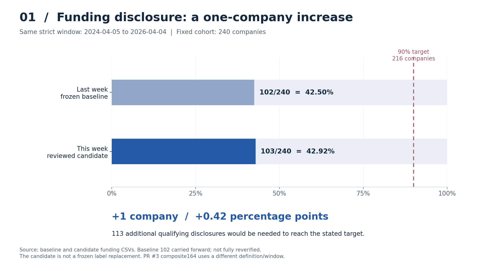
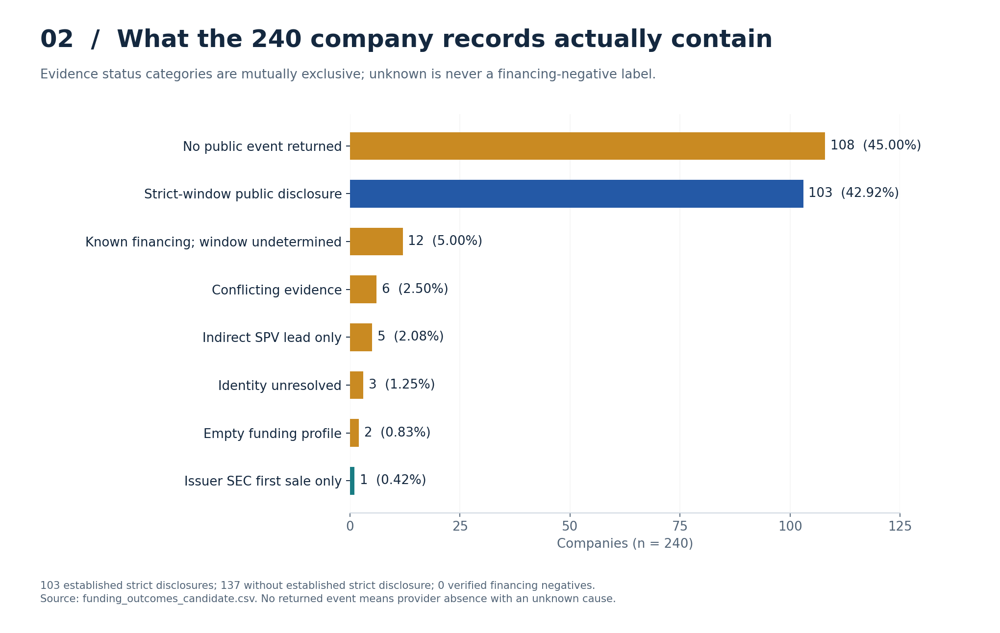
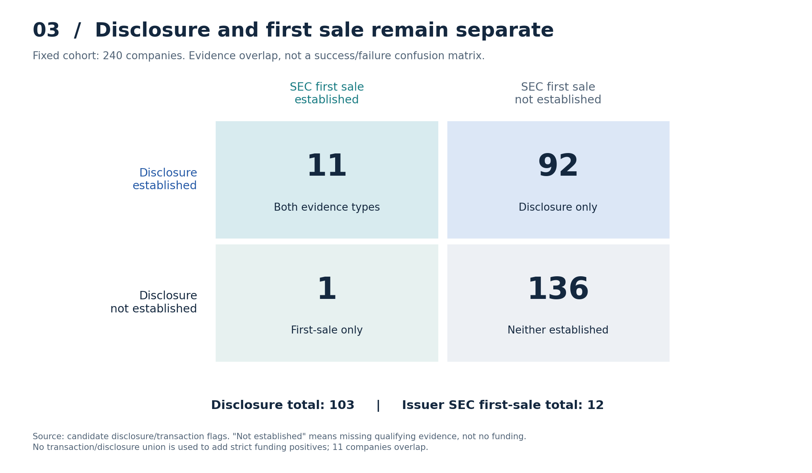
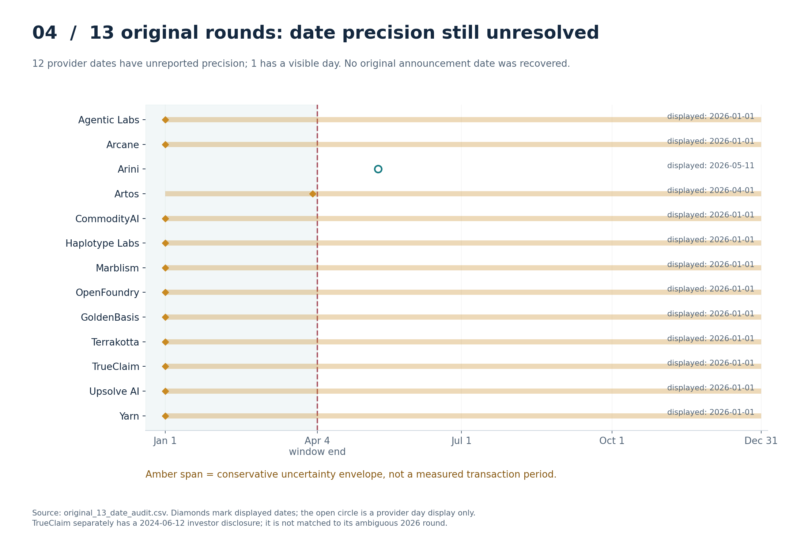
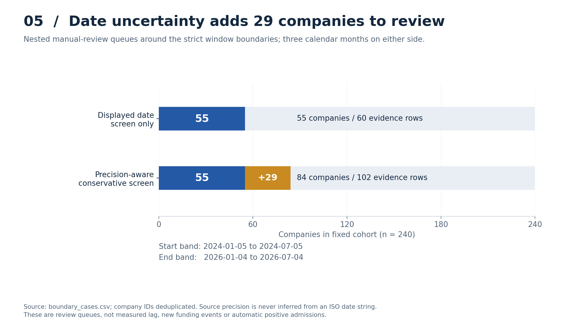
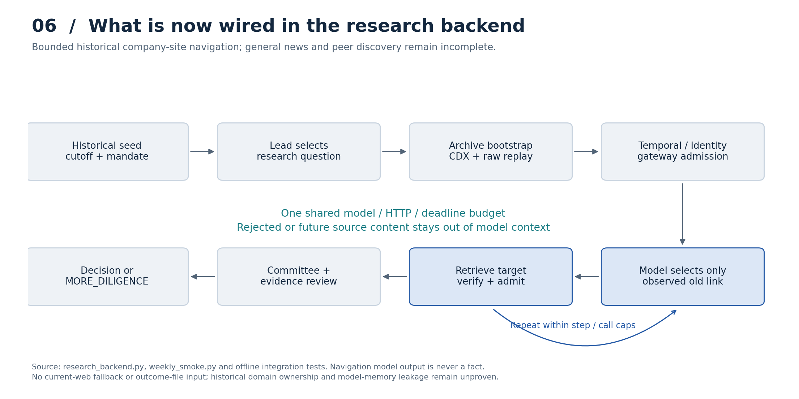
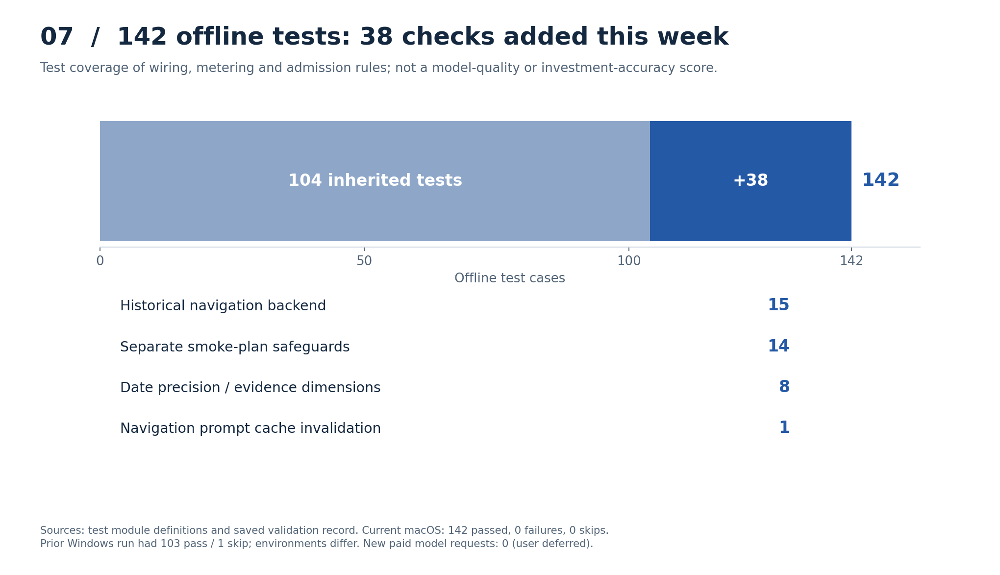

# 2026-11-19 圖表週報 / Visual weekly report

[開啟完整圖文報告](index.html) · [下載6頁PDF](weekly-progress-2026-11-19.pdf)

本報告補充完整數據、日期不確定性、來源差異與工程驗證。鎖定母體 **240 家**；嚴格結果窗口 **2024-04-05 至 2026-04-04**，決策資訊截止 **2024-04-04**。

可閱讀 [完整 HTML 圖文報告](index.html)；GitHub 下方亦可直接看圖。[完整文字週報](../2026-11-19-weekly-progress.md)保留方法與分工。

| 本週量測 | 結果與解讀 |
| --- | --- |
| 嚴格披露候選 | 103/240（42.92%），較上週 102 家增加 1 家、0.42 個百分點 |
| 距離 90% 覆蓋 | 需 216 家，尚差 113 家；不代表可將未知填成正例 |
| 未建立嚴格披露 | 137 家；融資負例仍為 0 |
| 原 13 筆輪次日期 | 0 筆補出原公告精度，13 筆保持未定 |
| SEC 交易維度 | 12 家，與披露重疊 11 家；不相加增加披露正例 |
| 邊界人工複核 | 顯示日期 55 家；考量精度不確定後 84 家（多 29 家） |
| 工程驗證 | 142 項離線測試通過；不代表模型品質或回測準確率 |
| 新模型執行 | 依使用者選擇，本週 0 次、US$0；Adagy 計畫已保存 |

## 1. 嚴格披露覆蓋：只增加一家公司

102 → 103 家，增加 0.42 個百分點。90% 代表 216 家，候選數距離目標仍差 113 家；這是證據覆蓋，並非投資成功率。

## 2. 240 家公司的資料缺口分布

103 家已建立嚴格窗內披露；其餘 137 家仍未建立。108 家屬未回傳公開事件，其他缺口另列；未知不能標為零或未融資。

## 3. 披露與 SEC 首售維度分開看

103 家披露與 12 家 SEC 首售中有 11 家重疊。交叉表只描述證據維度，不把兩者聯集用來增加嚴格披露正例。

## 4. 13 筆原輪次仍未補出公告精度

11 筆顯示 2026-01-01，Artos 顯示 2026-04-01，兩者均不能由格式推定為精確到日。Arini 顯示 2026-05-11，但原始來源仍鎖定。

## 5. 邊界複核：日期精度會擴大工作量

依顯示日期篩選為 55 家；把未報精度保守擴為整年後為 84 家，多出 29 家需查精度。這是人工複核清單，不是新的融資正例。

## 6. 研究後端：受限的歷史網站導覽

內容先經日期與實體 gateway，再供模型選擇當時已觀測的同網域路徑；每個目標另行查索引與重播。此階段尚非通用新聞／同業研究。

## 7. 離線測試擴充，不等於模型品質提升

測試由 104 項增至 142 項，新增 38 項：研究後端 15、smoke runner 14、日期稽核 8、prompt cache 1。全部為離線流程與防護檢查。

## 資料與解讀

TrueClaim 新增的是 2024-06-12 投資人披露證據，不是原 2026 年供應商輪次日期的解答。Haplotype 的 SEC 首次出售日為 2024-03-29，不能用較晚申報日移入窗口，也不能由單一窗前事件推定沒有後續融資。

PR #3 的 164/240 是不同窗口與定義的綜合觀測：153 筆融資觀測＋11 家額外狀態觀測，非 SEC 報道窗口延至 2026-07-04。它不是本週嚴格披露率，也不是一個可接到 102→103 的進步曲線。

- [240 家候選 CSV](../../../data/weekly_audit_20261119/funding_outcomes_candidate.csv)
- [原 13 家日期審核 CSV](../../../data/weekly_audit_20261119/original_13_date_audit.csv)
- [邊界案例 CSV](../../../data/weekly_audit_20261119/boundary_cases.csv)
- [圖表計算資料](../../../data/weekly_audit_20261119/report_metrics.json)
- [來源與日期語義](../../research_log/2026-11-19_funding_date_audit.md)
- [Smoke plan](../../../data/weekly_smoke_20261119/plan.json)

Prepared for Yi-Nung with AI assistance. Existing Rose Yu and team contribution provenance is preserved.
