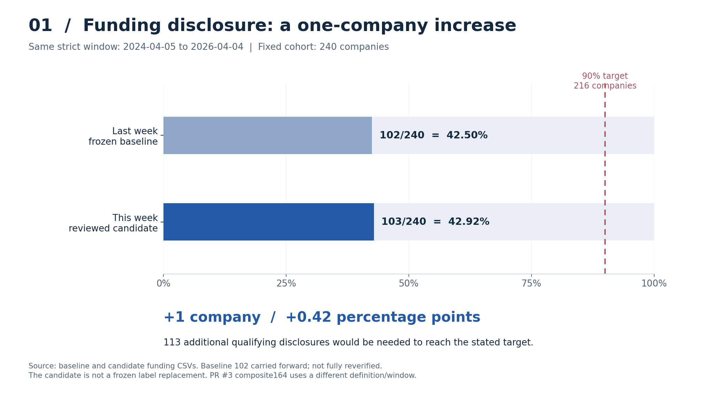
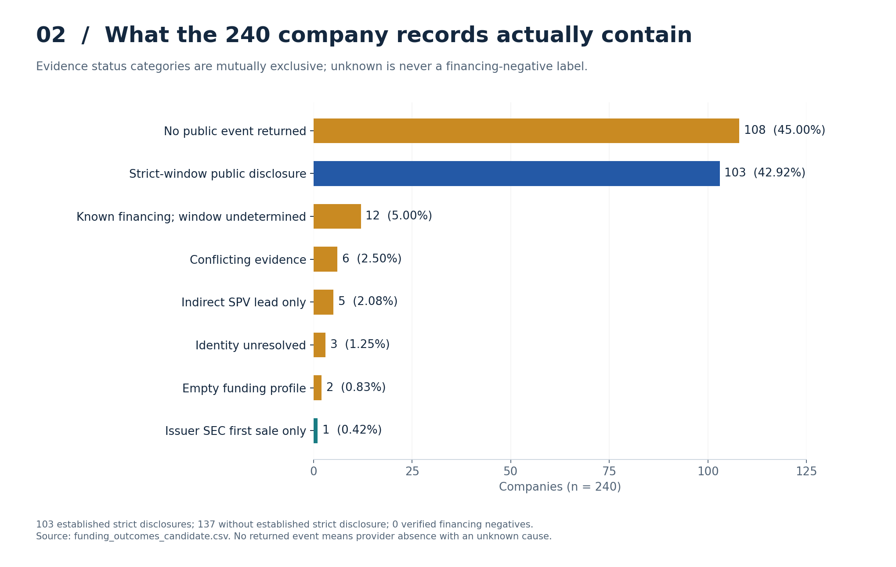
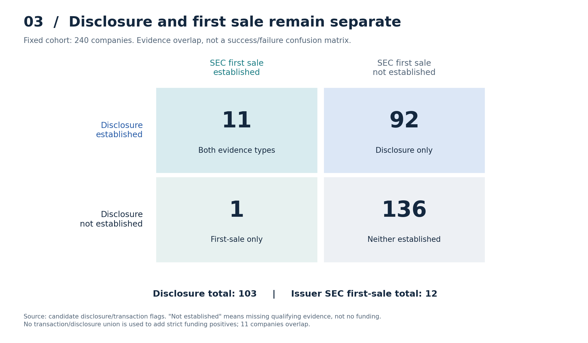
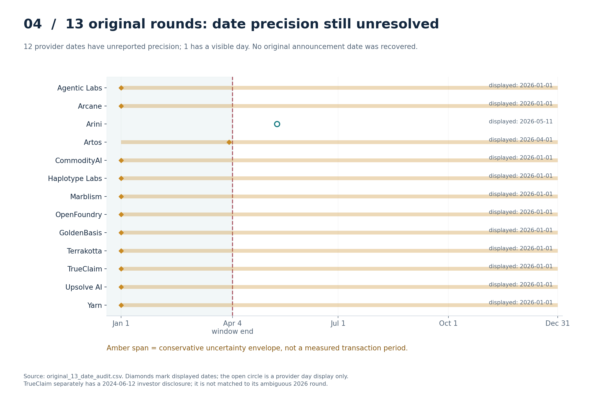
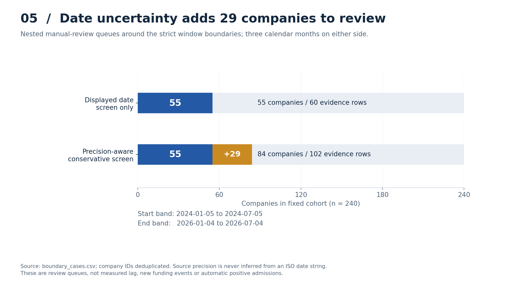
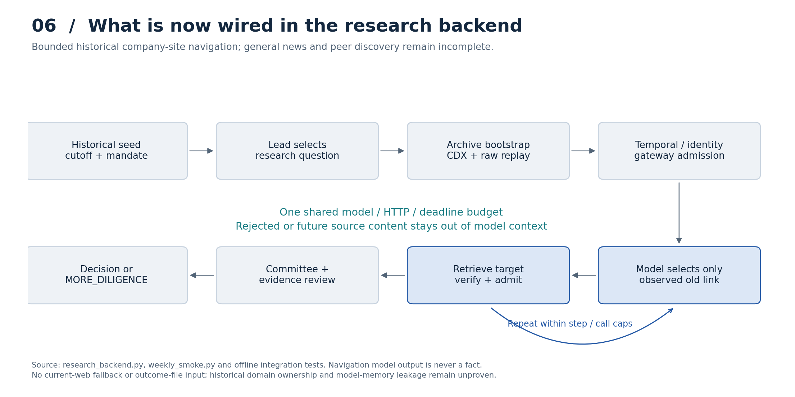
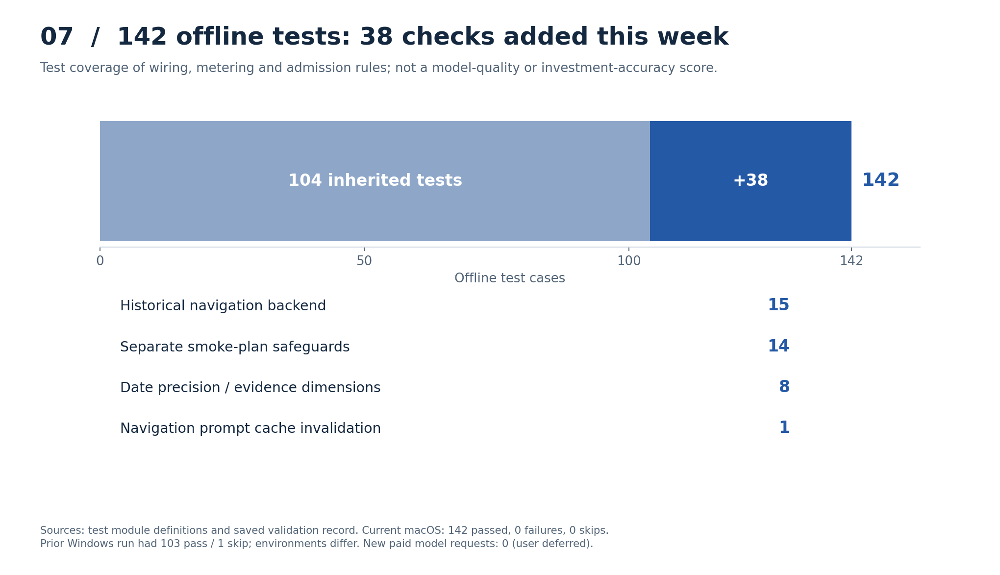

# Weekly progress — November 19, 2026 / 本週進度

Prepared for **Yi-Nung**, with AI-assisted development and source review. This
continues Rose Yu's shared runtime and data work in [PR #2](https://github.com/yh0728-hhe/4511-industry-project/pull/2)
and reviews the different outcome definition in [PR #3](https://github.com/yh0728-hhe/4511-industry-project/pull/3).
Existing contribution history and frozen snapshots are preserved.

**圖表版已補齊：** [中文圖文週報與下載](2026-11-19-visual-report/README.md) ·
[網頁版](2026-11-19-visual-report/index.html) ·
[六頁 PDF](2026-11-19-visual-report/weekly-progress-2026-11-19.pdf) ·
[完整分析數值](../../data/weekly_audit_20261119/report_metrics.json)。

本週資料上的實際增量是 **1 家公司、+0.4167 個百分點**；工程上的增量是受限歷史導覽後端與 **38 項新測試**。
這兩者要分開評估：嚴格披露覆蓋率仍僅 **42.92%**，距離 90% 目標還缺 **113 家合格披露證據**。
137 家沒有建立嚴格窗口披露，其中108家未返回公開事件，不能當成未融資。原13筆日期問題也沒有因新增TrueClaim公告而全部解決。

## 1. This week's objective / 本週目標

Turn last week's open items into reviewable work: inspect the original 13
undetermined funding records; separate date semantics and flag boundary cases;
define a separate, capped company smoke test; and begin a metered research loop
behind the existing temporal/identity gateway. The decision cutoff remains
**2024-04-04**, with a strict outcome window of **2024-04-05–2026-04-04**.

## 2. Status against last week / 狀態判斷

| Workstream | This week's evidence | Status |
| --- | --- | --- |
| Role specifications and reviewer handoff | Nine role cards/seven briefs retained; research card now describes the implemented scope. New navigation prompt is included in cache fingerprints. | On track |
| Original 13 date checks | First inspection recorded for all 13; **0 original round dates fully resolved, 13 remain undetermined**. One separate dated investor disclosure found. | Review delivered; resolution still off track |
| Strict public funding disclosure | Frozen baseline **102/240 (42.5%)**; new reviewed candidate **103/240 (42.9167%)**. SEC first-sale companies remain **12**, overlap **11**, kept separate. | Off track against 90% target |
| Per-source timing | Source/field semantics documented; reproducible boundary queue produced. No measured source-specific lag distribution. | Initial review delivered |
| Autonomous research backend | Bounded model-selected historical-link navigation wired to the existing runtime, gateway and shared budgets; offline tested. General news/peer discovery remains incomplete. | Partial implementation delivered |
| New real-company smoke test | Adagy Robotics plan and no-network preflight saved. **User explicitly deferred paid execution** on November 19. | Prepared; live run deferred |
| Offline validation | **142 tests passed, 0 failures, 0 skips** on this macOS checkout; four synthetic runtime scenarios passed. | On track; model quality unmeasured |

Tests use synthetic responses and injected transports. They verify control flow,
admission, accounting and failure behavior, not real-model research quality,
investment accuracy or a historical backtest.

## 3. Funding result and comparison rules / 數字與口徑

The single disclosure addition is **TrueClaim**: a dated investor newsletter
provides separate public disclosure evidence. It does not date the ambiguous
2026 provider round or establish a transaction date. The new 240-row candidate
changes only TrueClaim's disclosure fields; all transaction and negative-label
fields remain unchanged. [Audit table and definitions](../../data/weekly_audit_20261119/README.md).

The candidate has **137 companies without established strict-window disclosure**;
verified financing negatives remain **0**, so there is no two-class evaluation
set. The supplied last-week text says 117 companies had no returned event, while
the shared November 11 CSV specifically classifies 108 as
`UNKNOWN_NO_PUBLIC_EVENT_RETURNED`; other unknown categories are separate. The
shared files cannot reconcile that difference or explain provider absence. No
missing-event count becomes a negative label.

PR #3's CSV contains **164/240 composite observations: 153 financing observations
under its wider definition plus 11 status-only observations; 76 UNKNOWN**. Its
non-SEC report window extends to **2026-07-04**. These figures are reference
comparisons, not this week's strict funding-disclosure count or investment
success rate. We do not combine transaction and disclosure evidence to increase
strict positives or automatically adopt a three-month reporting grace.

### 圖 1：與上週比較，實際增加多少



只比較相同嚴格定義下的102與103。新候選距90%尚差47.08個百分點；113家是達既定比例所需的額外合格證據數，並非可達性預測。PR #3的164採不同口徑，因此未畫成同一條成長趨勢。

### 圖 2：未知資料到底卡在哪裡



240家相互排斥的狀態為：已披露103、未返回事件108、已知融資但窗口未定12、衝突6、間接SPV線索5、身分未解3、空白融資頁2、僅SEC證據1。後七類合計137家；**沒有任何一類可直接改成負例**。117這個上週文字數與共享CSV的108屬尚未釐清的來源差異。

### 圖 3：披露與交易證據重疊，不是融資分類正確率



11家同時有兩種證據、92家只有嚴格披露、1家只有SEC、136家兩者均未建立。這是證據重疊表，不是成功／失敗的confusion matrix，也不把聯集拿來增加嚴格披露正例。

The pinned PR #3 review also found two reproducible issues: its manifest hashes
CRLF CSV bytes while Git stores LF, causing its original validator to fail; the
Chinese opening paragraph retains financing150/UNKNOWN79 rather than
153/76. [Review record](../../data/weekly_audit_20261119/upstream_pr3_review.json)
and [reproduction script](../../scripts/review_shared_snapshot.py). This branch
records the findings without editing PR #3's rows or branch.

## 4. Completed deliverables / 本週完成

- [Company-by-company date audit and timing policy](../research_log/2026-11-19_funding_date_audit.md),
  including primary-source reads, inaccessible originals, explicit precision and
  a reproducible candidate. All 13 original provider-round dates remain held.
- [Boundary-case CSV](../../data/weekly_audit_20261119/boundary_cases.csv): the
  displayed-date screen gives **60 evidence rows / 55 companies**; conservatively
  widening unreported precision to its reported year gives **102 rows / 84
  companies** potentially overlapping a review band. These are review queues,
  not newly admitted positives. Dates are never shifted.
- [MeteredResearchProvider](../../src/closed_loop/research_backend.py) and
  [design](../architecture/metered_research_backend.md): admit archived content
  before planning, select only observed same-domain historical paths, independently
  verify targets, and share model/HTTP/deadline budgets. Invalid plans, provider
  errors and metering failures stop further dispatch.
- [Separate smoke runner](../../experiments/closed_loop_offline/weekly_smoke.py)
  and [saved plan](../../data/weekly_smoke_20261119/plan.json): one company,
  **24 API requests, US$0.20 proposed conservative reservations, six archive HTTP
  requests, eight minutes, two research passes**. Default preflight loads no key,
  reads no Y and makes zero network calls. The sealed Abel pilot is not reused.
- Smoke failure regressions cover missing usage, provider/accounting errors,
  invalid citations and queued asynchronous siblings; rejected reruns preserve
  previous results. Execution requires a fresh approval of the canonical plan.
- Added an offline GitHub Actions workflow and corrected a macOS portability
  assumption in the existing socket test. Ordinary backend failure policy remains
  unchanged; the smoke runner opts into terminal semantic-validation errors.

### 圖 4：13筆日期查核的實際結果



11筆顯示2026-01-01，Artos顯示2026-04-01，但這12筆皆無原始精度，因此圖上用「可能涵蓋全年」表示保守不確定區間，並非聲稱資金在整年發生。Arini能讀到供應商顯示的2026-05-11，仍沒有原始公告可核對。13筆原輪次全數維持未定。TrueClaim另有2024-06-12投資人披露，不能誤接成其2026輪次日期。

### 圖 5：日期精度如何增加人工複核工作量



只看顯示日期時，55家公司接近起訖邊界；把未報精度的日期保守擴張後，清單變84家，**多出29家**。55家清單被84家清單包含，兩者不能相加成139家。102證據列與84公司不同，是因同一家公司可能有多筆證據。三個月只是審查帶，未平移日期。

### 圖 6：本週後端到底接上哪個環節



新完成的是「只從已驗證歷史頁面觀察到的連結中選下一頁」，每個目標仍要重新核對archive內容與日期，再經gateway。它不是已完成的任意網路研究，也沒有新增新聞或同業搜尋品質結果。

## 5. Validation and reproducibility / 驗證

From the repository root, with Python 3.10 or later and no model SDK or key needed:

```sh
PYTHONPATH=src python3 -m unittest discover -s tests -p 'test_*.py' -q
python3 scripts/audit_funding_dates.py
python3 experiments/closed_loop_offline/weekly_smoke.py
python3 experiments/closed_loop_offline/run_fixtures.py /tmp/4511-fixture-runs.json
```

The tests require local loopback sockets for IPC and otherwise use offline
fixtures. The audit manifest hashes the source inputs and generated outputs;
new CSV artifacts use LF consistently. The offline rebuild cannot reproduce the
manual web reads. The pinned PR #3 review additionally requires that commit's
Git objects locally; fetch its branch before running the review script.

### 圖 7：測試增加了哪些覆蓋，沒有證明哪些事情



新增38項：歷史導覽15、smoke防護14、日期與證據維度8、prompt快取1。142項通過能支持流程與停止規則，不代表142次真實公司研究，更不是模型準確率。本週真實付費模型請求仍為0。

Crunchbase access was tested without saving the key or raw business payload:
the current endpoint returned **401 / LA401 / Unauthorized user_key**, and the
legacy endpoint returned **404 / AV404 / Data api key is not live**.
[Redacted access record](../../data/weekly_audit_20261119/api_access_check.json).
No funding data or precision was obtained through that credential.

## 6. Remaining limits / 尚未完成與風險

Original announcement recovery is incomplete; a formatted ISO date does not
establish its precision. SEC first sale, filing date, provider announcement date
and close date remain different fields. The approximately three-month lag is an
unmeasured review heuristic, not a universal correction. Baseline 102 disclosures
were carried forward rather than reverified in full.

The backend currently navigates historical company websites. Broader news/peer
research, independent historical domain ownership, source correctness and model
quality are not established. The gateway excludes retrieved post-cutoff content;
absence of pretrained future knowledge is not proven. Outcome-audit files are
excluded from the experiment's input routes. No new paid model run occurred.

## 7. Next priorities / 下一步優先順序

1. Recover original company/investor announcements for the 13 held rounds, using
   working entitled access or individually readable dated originals. Retain holds
   where precision or event identity cannot be established.
2. Review the boundary queue and assemble matched transaction/announcement pairs
   before estimating source-specific lag or changing an observation window.
3. Resolve the supplied Crunchbase credential's access state with its owner;
   independently review the TrueClaim candidate addition and PR #3 consistency
   findings.
4. If later authorized, recheck the pinned model/rate card and run only the saved
   capped Adagy plan with existing model API configuration. This week remains
   preparation only by user choice.
5. Extend trusted historical news/peer adapters after the bounded website backend
   has real-run evidence; preserve the same admission and spending boundaries.

## 8. Ownership and sponsor question / 分工與待確認問題

**Yue Yu:** original-announcement recovery, date precision and source-by-source
adjudication; retain the baseline research provenance. **Yi-Nung:** this week's
metered backend integration, smoke plan, offline verification and shared weekly
handoff, with AI assistance. This report does not claim others completed pending
work, and does not claim sole authorship of the existing runtime/data.

**Question for Jeff:** What evidence supports the approximately three-month lag,
which source types/population does it cover, and is it intended as a manual-review
band or a separately approved reporting-window rule? This question is recorded
for the team; no message has been sent on the user's behalf.

中文重點：本週已交付日期稽核、邊界清單、受限歷史研究後端、獨立 smoke test
計畫及142項通過的離線測試。嚴格披露候選數由102增至103，但13筆原輪次日期
仍未確定，未驗證負例仍為0。PR #3的164筆綜合觀測採不同口徑，不能替換此數字。
依使用者選擇，本次不上付費模型；尚未完成項目如實保留。
